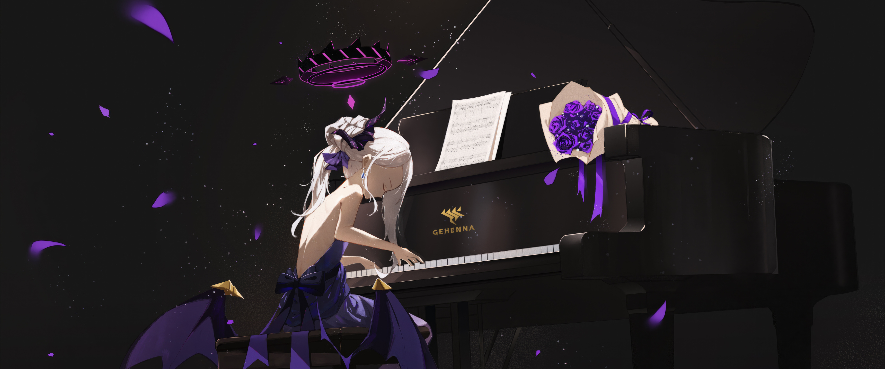

# Omarchy Hina Theme

Hina is a dark palette sampled directly from the *Sorasaki Hina* (Blue Archive) piano wallpaper: a near-black charcoal background from the stage and piano, a violet accent from the rose petals and ribbons, magenta from the halo, soft off-white from her hair and the sheet music, and gold from the Gehenna emblem. Gaps, corner rounding, and animations are all matched to the X-1632 theme (`gaps_in = 6`, `gaps_out = 8`, `rounding = 22`, `rounding_power = 1`).

## Install

```bash
omarchy theme install https://github.com/Korgen-Jurai/omarchy-hina-theme.git
```

## What's included

- Terminal palette (`colors.toml`) — drives Alacritty, Kitty, Foot, Ghostty, btop, VS Code, Obsidian, and more via Omarchy's built-in templates
- Hyprland gaps/borders/rounding/animations (`hyprland.lua`)
- Icon theme pointer (`icons.theme` → Yaru-purple-dark)
- Wallpaper (`backgrounds/1-hina.jpg`)

## Wallpaper


